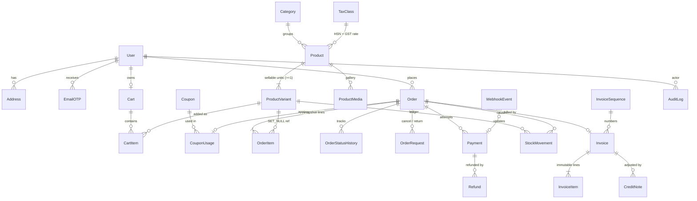

# Life Line Dynamics — Architecture

## 1. Architecture overview

A single Django 5.2 LTS monolith rendering server-side templates (Bootstrap 5 + small vanilla JS). No separate frontend server, no microservices.

```
 Browser / Android app (TWA)
          │  HTTPS
          ▼
 PythonAnywhere web worker ──► Django (config/)
          │                     ├─ core        site settings, static pages, errors, SEO, audit log
          │                     ├─ accounts    custom User, EmailOTP, Address, auth flows
          │                     ├─ products    Category, Product, ProductVariant, ProductMedia, TaxClass
          │                     ├─ cart        Cart, CartItem, Coupon, CouponUsage
          │                     ├─ orders      Order, OrderItem, OrderStatusHistory, OrderRequest
          │                     ├─ inventory   StockMovement ledger, low-stock alerts
          │                     ├─ payments    Payment, Refund, WebhookEvent, gateway abstraction
          │                     ├─ invoicing   Invoice, InvoiceItem, CreditNote, InvoiceSequence, PDF
          │                     └─ dashboard   staff dashboard, reports, CSV export
          ▼
 MySQL (prod) / SQLite (dev)      MEDIA_ROOT (public images)   PRIVATE_MEDIA_ROOT (invoice PDFs)
          │
 External: Razorpay API + webhooks · SMTP provider · (Phase 2) Amazon SP-API
```

Key principles:

- **Server is the source of truth.** Prices, discounts, shipping, tax and payment status are always recalculated or verified on the server.
- **Money uses `Decimal` only**, rounded with explicit rules stored in settings.
- **Snapshots, not references, for history.** Orders and invoices copy name, SKU, price, HSN, GST rate and addresses at the moment of sale.
- **Ledgers for anything that moves.** Stock changes go through `StockMovement`; invoice numbers through `InvoiceSequence` with row locking.
- **Idempotency** for webhooks and stock movements via unique keys (`WebhookEvent.event_id`, `StockMovement.idempotency_key`).
- **Separate status fields**: `order_status`, `payment_status`, `fulfilment_status` (shipping), and `invoice` presence.
- **Secrets only in environment variables.** `.env` locally, the WSGI file / `.env` on the server.

## 2. Folder structure

```
lifeline/
├── manage.py                    # dev settings by default; `test` uses test settings
├── requirements.txt             # production pins (includes mysqlclient)
├── requirements-dev.txt         # Windows/SQLite pins (no MySQL driver)
├── .env.example  .gitignore  README.md
├── config/
│   ├── settings/
│   │   ├── base.py              # shared, env-driven
│   │   ├── dev.py               # DEBUG, console email
│   │   ├── test.py              # in-memory DB, dummy keys
│   │   └── prod.py              # HTTPS, secure cookies, HSTS, startup guards
│   ├── urls.py  wsgi.py  asgi.py
├── apps/
│   ├── core/  accounts/  products/  cart/  orders/
│   ├── inventory/  payments/  invoicing/  dashboard/
│   └── (Phase 2) marketplace/   # Amazon SP-API, isolated
├── templates/                   # base.html, errors/, per-app folders
├── static/  css/ js/ img/  (+ manifest.json, service worker in Stage 12)
├── media/                       # public product images/videos (git-ignored)
├── private_media/               # invoice PDFs, served only via permission checks
├── logs/
└── docs/                        # architecture, deployment, security, launch checklists
```

## 3. Database relationship design



Notes on the design and deliberate changes to the proposed model list:

| Area | Decision | Why |
|---|---|---|
| Sellable unit | Every product has ≥1 `ProductVariant` (a "default" one is created automatically). SKU, MRP, selling price, cost price, stock, weight live on the variant. | One code path for cart, stock and invoices whether a product has sizes/pack counts or not. |
| Tax | New `TaxClass` (name, HSN, GST rate, effective date) referenced by products. | Accountant confirms a few tax classes once; products can't drift to invalid rates. |
| Invoice numbers | New `InvoiceSequence` (prefix, financial year, next number), locked with `select_for_update`. | Gap-free, concurrency-safe numbering per FY series. |
| Webhooks | New `WebhookEvent` (gateway, event_id unique, payload hash, processed_at). | Duplicate deliveries become no-ops. |
| Cancel/return | New `OrderRequest` (type, status, reason, inspected_by, restock_approved). | Staff-approved restocking; no automatic restock. |
| Shipment | Courier name, AWB/tracking number, shipped/delivered timestamps as fields on `Order`. | No courier integration in v1; a separate model adds nothing yet. |
| Settings | `SiteSettings` singleton holds business/GST profile, shipping, COD, return and invoice-trigger settings. | Editable in admin, no code changes. |
| Deletion | `PROTECT` from orders/invoices to products and users; products are archived, not deleted. | History and tax records must survive. |

Indexes are planned on: `Product.slug`, `ProductVariant.sku` (unique), `Order.order_number` (unique), `Order(user, created_at)`, `Order(order_status)`, `Payment.gateway_order_id` / `gateway_payment_id` (unique), `Invoice(series, number)` (unique), `StockMovement(variant, created_at)`.

Order numbers are human-readable and non-sequential, e.g. `LLD-261018-7K4Q9` (date + random base32), with a uniqueness retry.

**Invoice timing (needs your CA's confirmation):** the default design issues the tax invoice when goods are dispatched (status → Shipped), with a setting to issue on payment instead. Prepaid orders paid before dispatch may need different documentation — this will be configurable, not hardcoded. E-invoicing (IRN/QR) is off by default; it generally concerns B2B supplies above a notified turnover threshold — confirm applicability with your CA.

## 4. External services and credentials required

| Service | Needed for | What you must provide | When |
|---|---|---|---|
| GitHub (private repo) | Source code | Account + repo | Stage 10 (can start now) |
| PythonAnywhere | Hosting | Paid plan (see below), username | Stage 10 |
| Domain registrar | Custom domain | Domain + DNS access (CNAME) | Stage 10 |
| Razorpay | Online payments | Business KYC; test Key ID/Secret; webhook secret; later live keys | Stage 6 (test keys only) |
| SMTP provider | Transactional email | Host, port, username, password/app password, verified sender | Stage 4/8 |
| CA / accountant | GST correctness | GSTIN, legal & trade name, registered address, state code, HSN codes and GST rates per product, invoice series format, invoice timing | Before Stage 7 goes live |
| Google Play Console | Android app | Developer account (one-time fee), app signing key | Stage 12 |
| Amazon Seller Central + SP-API | Phase 2 | Seller account, developer registration, LWA credentials | Post-launch |

### PythonAnywhere plan check (verified October 2026)

- **Beginner (free):** app only at `username.pythonanywhere.com`; outbound internet limited to an allow-list of sites; for new accounts MySQL and scheduled tasks are no longer included; 512 MB storage. SMTP only via Gmail, or HTTP APIs of allow-listed providers.
- **Developer (~$10/month):** custom domain, unrestricted outbound internet, MySQL, 20 scheduled tasks, 1 always-on task, 5 GB storage, **1 web app**.
- Free SSL is available on all plans.

**Recommendation:** use the Developer plan for production — the store needs MySQL, a custom domain, outbound access to the Razorpay API, and scheduled tasks (email retries, payment reconciliation, low-stock alerts). Note it allows one web app, so other projects need their own account or a VPS. Free fallback for a demo only: SQLite + Gmail SMTP on `username.pythonanywhere.com`.

## 5. Local development setup (Windows)

```powershell
# 1. Install Python 3.12 or 3.13 from python.org (tick "Add to PATH"), and Git.
cd C:\Projects
# (copy/clone the lifeline folder here)
cd lifeline

# 2. Virtual environment
python -m venv venv
venv\Scripts\activate

# 3. Dependencies (SQLite; no MySQL driver needed locally)
python -m pip install --upgrade pip
pip install -r requirements-dev.txt

# 4. Environment file
copy .env.example .env
python -c "import secrets; print(secrets.token_urlsafe(64))"
#   paste the output after DJANGO_SECRET_KEY= in .env

# 5. Database + admin user
python manage.py migrate
python manage.py createsuperuser

# 6. Run checks and tests
python manage.py check
python manage.py test

# 7. Start the server
python manage.py runserver
#   Site:  http://127.0.0.1:8000/
#   Admin: http://127.0.0.1:8000/manage-lld/
```

## 6. Build status

| Stage | Scope | Status |
|---|---|---|
| 1 | Architecture, settings, apps, custom user, security baseline | Built and tested |
| 2 | Store settings singleton, staff roles, admin, audit log, MySQL config | Built and tested |
| 3 | Catalogue, tax classes, variants, media validation, storefront, SEO, sample data | Built and tested |
| 4 | Registration, email OTP, OTP login, password reset/change, profile, addresses | Built and tested |
| 5 | Cart, coupons, GST pricing engine, checkout, orders, stock ledger, COD | Built and tested |
| 6 | Razorpay (test mode), signatures, webhooks, idempotency, retry, refunds, reconciliation | Built and tested with mocked gateway; **live test needs your keys** |
| 7 | GST invoices, numbering, PDF, register, credit notes | Built and tested; **tax values need CA confirmation** |
| 8 | Emails, staff dashboard, reports, CSV | Built and tested; **SMTP needs your credentials** |
| 9 | Automated tests, security review, lint | 158 tests passing; `check --deploy` clean apart from HSTS notes |
| 10 | GitHub + PythonAnywhere | Guide written (DEPLOYMENT_PYTHONANYWHERE.md); **deployment is done by you** |
| 11 | Production acceptance | LAUNCH_CHECKLIST.md |
| 12 | Google Play app | PWA built into the site; packaging guide in PLAY_STORE.md |
| Phase 2 | Amazon SP-API | Groundwork + design (AMAZON_PHASE2.md); disabled |

### Models added beyond the original list (and why)

`TaxClass` (CA-confirmed HSN + rate), `InvoiceSequence` (locked FY numbering), `WebhookEvent`
(duplicate webhook detection), `OrderRequest` (cancel/return with inspection), `Page`, `Banner`,
`ContactMessage` (editable content), `SkuMapping` (Amazon phase 2). Shipment details are fields on
`Order` rather than a separate model, because there is no courier integration yet.

## 7. Google Play Store app (Stage 12)

**Approach: Progressive Web App + Trusted Web Activity (TWA).** The Django site is made installable (web manifest, icons, service worker for an offline page), then wrapped as an Android app with Google's Bubblewrap CLI or PWABuilder and uploaded to Play Console as an `.aab`.

Why this approach:
- One codebase, one database, one admin — products, prices, orders and invoices stay in sync automatically.
- Fits the mandated stack (no React Native/Flutter, no separate API server).
- Razorpay checkout runs as on the website. Google Play Billing is for digital goods; physical goods like agarbatti can use your own payment gateway.
- Updates to the website appear in the app without a new Play release.

What it needs:
1. Site live on a custom domain with HTTPS (Stage 10).
2. `manifest.json`, app icons (512×512 + maskable), service worker with an offline fallback page — built into the templates from Stage 3 onward.
3. Digital Asset Links file at `https://yourdomain/.well-known/assetlinks.json` (served by Django) containing the app's signing-key fingerprint, so Android shows it full-screen without a browser bar.
4. Google Play Console developer account, store listing (screenshots, description, privacy policy URL — the Privacy Policy page from Stage 3), Data Safety form, content rating.
5. Testing track (internal → closed testing) before production release; new personal developer accounts may have to complete a closed test with testers before going to production — check the current Play Console requirements when you enrol.

Later options if needed: push notifications (Firebase Cloud Messaging) for order updates; a fully native app only if TWA proves limiting.
